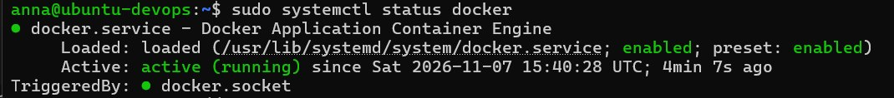
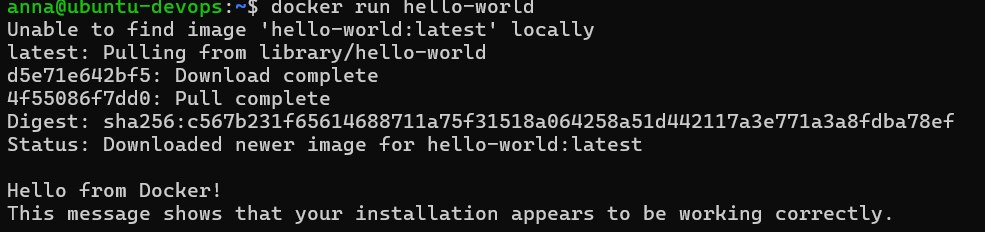
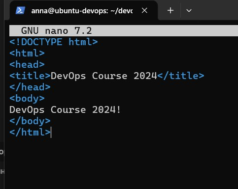
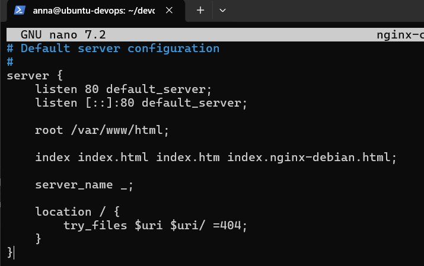
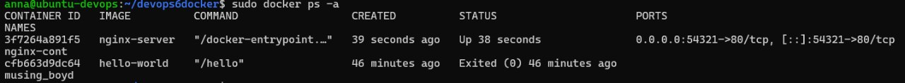
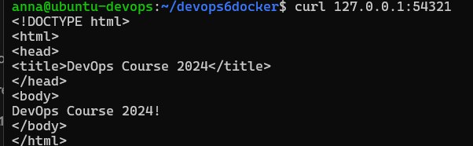
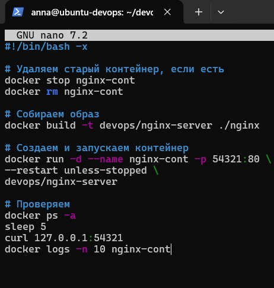
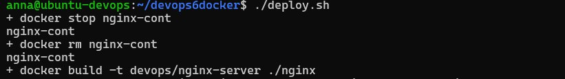
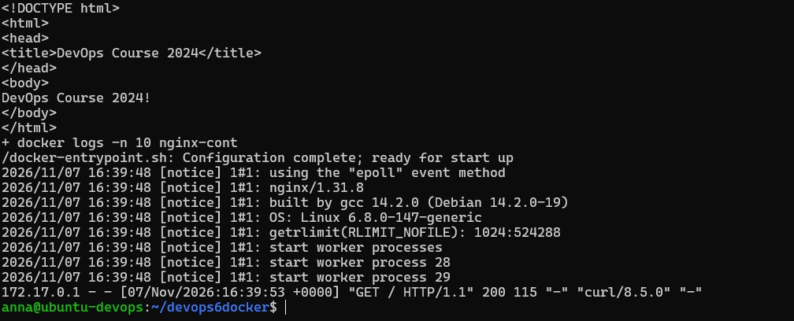

# Лабораторная работа №7: Docker & Nginx Deployment

## Структура проекта
- `nginx/` — файлы конфигурации и веб-страница:
  - `Dockerfile` — инструкции для сборки образа.
  - `nginx-conf/nginx.conf` — конфигурация сервера Nginx.
  - `index.html` — главная HTML-страница.
- `deploy.sh` — скрипт для автоматической пересборки и перезапуска контейнера.
- `screenshots/` — скриншоты выполнения работы.

## Ход выполнения работы

### 1. Проверка работы Docker
Проверка статуса службы Docker после установки (`active (running)`):

Тестовый запуск контейнера `hello-world` для проверки корректности работы Docker:

### 2. Подготовка файлов проекта
Создание индексной страницы `index.html`:

Настройка конфигурационного файла `nginx.conf` для прослушивания 80-го порта:

### 3. Ручной запуск и проверка контейнера
Сборка образа и проверка списка запущенных контейнеров (`docker ps -a`) — контейнер `nginx-cont` запущен, порт `54321` проброшен на `80`:

Проверка доступности веб-сервера через `curl 127.0.0.1:54321`:

### 4. Автоматизация деплоя
Создание bash-скрипта `deploy.sh` для автоматического пересоздания контейнера и проверки его работы:

Запуск `./deploy.sh`: остановка старого контейнера, удаление и сборка нового образа:

Завершение работы `./deploy.sh`: вывод HTML-страницы и логов контейнера с кодом ответа `200 OK`:
